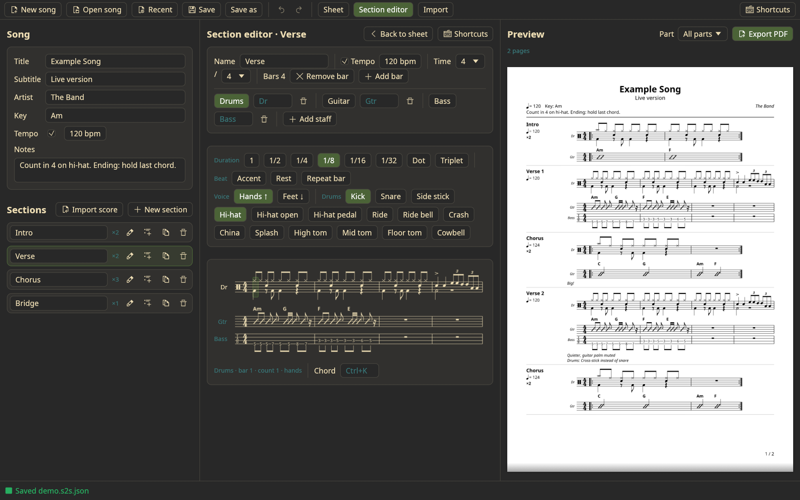
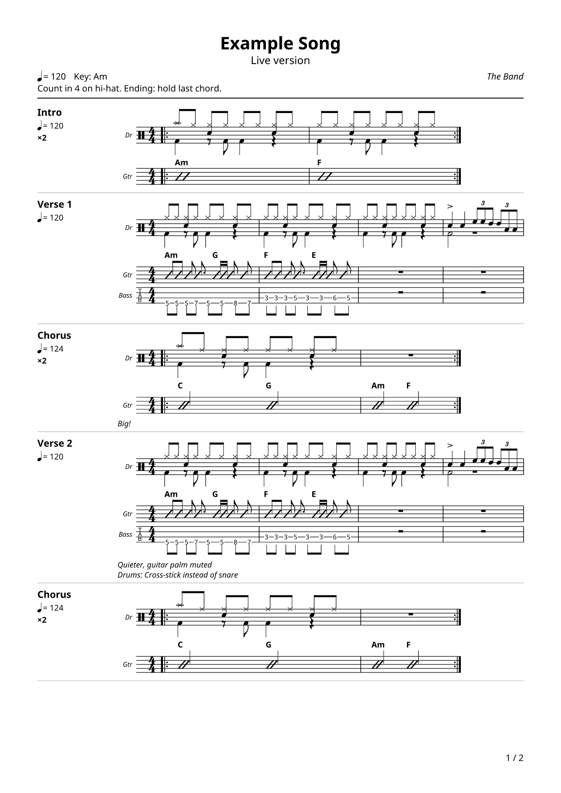

# song2sheet

**Compact song sheets for bands.** One line per song section (intro, verse, chorus…), each with its tempo, a short bit of notation and a few comments, all on one or two A4 pages. Every player can print a version with only their own part.



## Why song2sheet?

A full score of a three-minute song runs to many pages. In rehearsal or on stage, nobody reads that. What a band actually needs is the **shape** of the song:

- which sections come in which order, and how often each is played,
- the tempo, and where it changes,
- the one thing each player has to remember for that section: the drum groove, the chord rhythm, the bass riff,
- short cues like "quieter", "cross-stick instead of snare" or "hold the last chord".

Bands usually scribble this on paper or type it into a word processor, which can't hold any notation. Notation programs can, but they lay out whole scores, not a compact one-line-per-section overview.

song2sheet sits in between. You pull the important bars out of an existing score (or type them in quickly), arrange the sections into the song's form and export a tidy PDF. The drummer prints only the drum staff and the drum comments; the guitarist gets chords and their own notes. It all comes from the same file.



## What it does

- **Import from a score:** read MusicXML files exported from MuseScore or Guitar Pro, pick the parts you need and select a bar range to turn into a section.
- **Quick rhythm editor:** write or fix a section from the keyboard, in the style of MuseScore and Guitar Pro. It handles drum grooves, rhythm slashes with chord symbols, and guitar or bass tab.
- **Reuse sections:** a verse that is played three times is written once and placed on the sheet three times, with a repeat count on each row.
- **Comments:** for the whole band, or shown only on one part's sheet.
- **Exact preview:** the preview next to the editor is exactly what will be printed.
- **One PDF per player:** export all parts, or just one.

## How it works

The window has three areas: your **Sections** on the left, the current screen in the middle (**Sheet**, **Section editor** or **Import**) and the print **Preview** on the right.

### Make a sheet from an existing score

1. In MuseScore or Guitar Pro, export the song as MusicXML (*File → Export*).
2. In song2sheet, click **Import score** and choose the file.
3. Tick the parts you want, for example drums and guitar.
4. In the overview, click the first bar of a section and Shift+click its last bar. Name the section (say, "Chorus") and click **Create section**.
5. Repeat for the other sections, then add each one to the sheet with the *Add to the end of the sheet* button on its row.

### Write a section from scratch

Click **New section** to open an empty section in the **Section editor**. A cursor moves from beat to beat, and you type:

- **←/→** move between beats; **↑/↓** switch staff (on guitar and bass: switch string)
- **2–7** set the length, MuseScore style (4 = eighth, 5 = quarter); **+/−** longer/shorter; **.** dotted; **Ctrl+3** triplet
- **Drums:** K kick, S snare, H hi-hat, R ride, C crash, T/M/F toms; V switches between hands and feet
- **Guitar/bass:** digits type frets; N adds a rhythm slash; **Ctrl+K** adds a chord symbol
- **Del** makes a rest; **Ctrl+R** repeats the bar

On macOS, use Cmd instead of Ctrl. The full list is under **Shortcuts** in the top bar.

### Arrange the song

On the **Sheet** screen, drag rows into the song's order and set how often each section is played. Add a comment for everyone or one only for a specific part. The song's title, artist, key, tempo and general notes go into the **Song** details above the sections; a section can set its own tempo in the editor.

### Print a sheet for each player

Above the preview, choose **All parts** or a single part and click **Export PDF**. Do it once per player, and everyone gets a sheet with just what they need.

Songs are saved as `*.s2s.json`: small text files that are easy to send around or keep under version control.

## Installation

song2sheet is a native desktop app written in Rust for Linux, macOS and Windows. It is developed on Linux; the macOS and Windows builds are tested automatically but see less use. There are no prebuilt downloads yet, so you build it yourself:

1. Install Rust from <https://rustup.rs>.
2. Clone this repository and, inside it, run the install script for your system.

**Linux and macOS:**

```sh
./install.sh              # for your user
./install.sh --system     # or for all users (uses sudo)
```

This builds the app and installs the `song2sheet` command, in `~/.local/bin` (or `/usr/local/bin` for all users). On Linux it also adds song2sheet to your app menu. On macOS it puts song2sheet in your Applications folder (`~/Applications`, or `/Applications` for all users). Then start it from there, or from a terminal:

```sh
song2sheet                     # start the app
song2sheet song.s2s.json       # start with a song open
```

To remove it, run `./install.sh --uninstall` (with `--system` if you installed it for all users). If you installed an earlier version with `cargo install`, remove that copy with `cargo uninstall song2sheet`, or it may run instead of the new one.

**Windows** (in PowerShell):

```powershell
powershell -ExecutionPolicy Bypass -File install.ps1
```

This builds the app, installs it for your user in `%LOCALAPPDATA%\Programs\song2sheet` and adds it to the Start menu. To remove it, run the same command with `-Uninstall` at the end.

To try song2sheet without installing it, run `cargo run --release -p song2sheet`.

On Linux, the app takes its icon from your icon theme (the music note `audio-x-generic`) and follows KDE's light/dark colours and accent colour. On macOS and Windows it has no app icon yet.

Under the hood, the UI is built with egui. The notation is engraved with the Bravura music font, and the preview and the PDF are drawn by the same code, which is why they always match.

## Status

The workflow works end to end: import, edit, arrange and export. The scope is deliberately small. song2sheet makes compact band sheets and is not meant to be a full notation program.

Not supported yet: opening Guitar Pro files (`.gp`) directly. Export MusicXML from Guitar Pro instead.

## Development

Run the tests with `cargo test --workspace`. The architecture and code conventions are in [`CLAUDE.md`](CLAUDE.md), and the UI guidelines are in [`docs/DESIGN.md`](docs/DESIGN.md).

## Credits

Fonts: [Bravura](https://github.com/steinbergmedia/bravura) and [Noto Sans](https://fonts.google.com/noto/specimen/Noto+Sans) (SIL Open Font License), and [Phosphor Icons](https://phosphoricons.com) (MIT).
